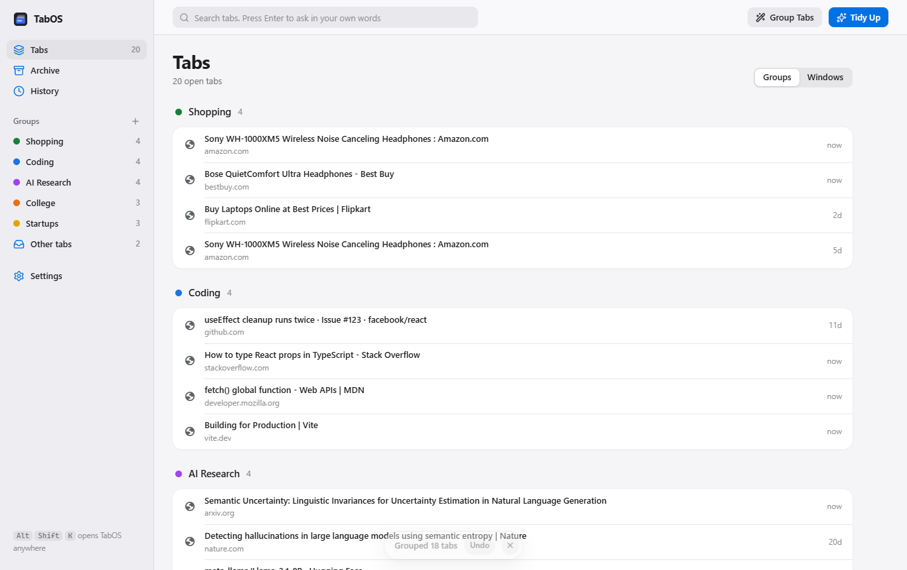
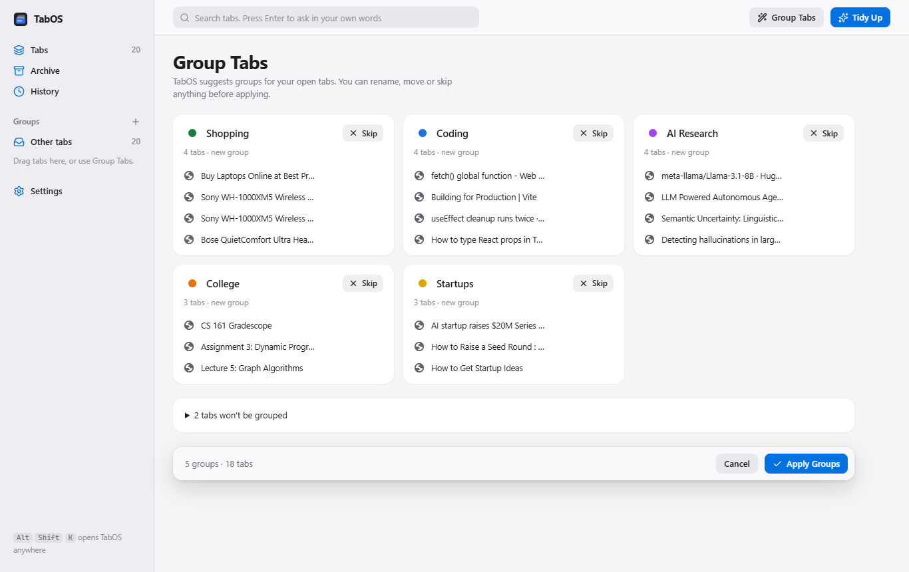
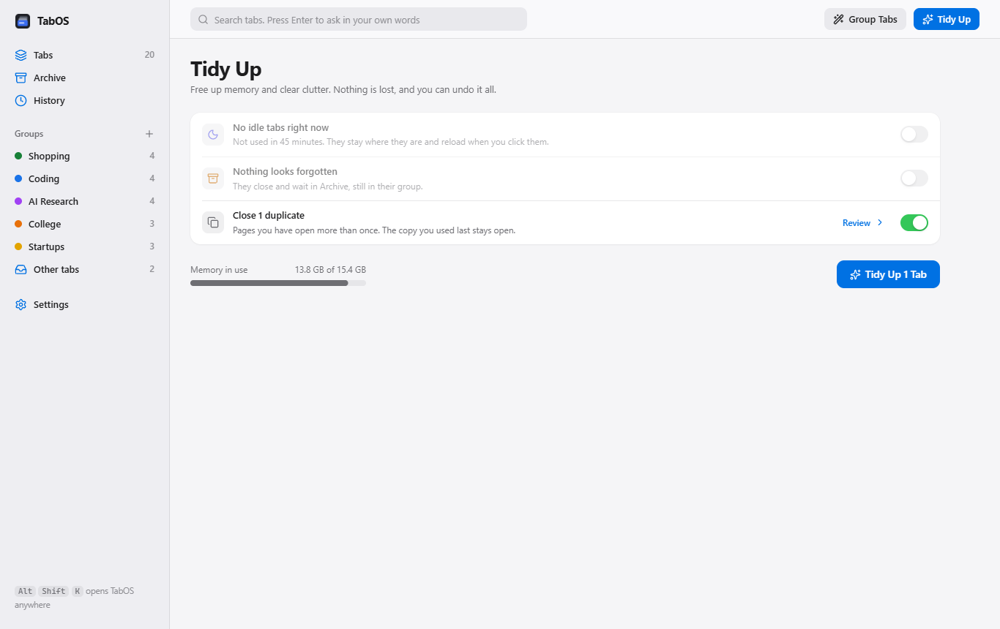
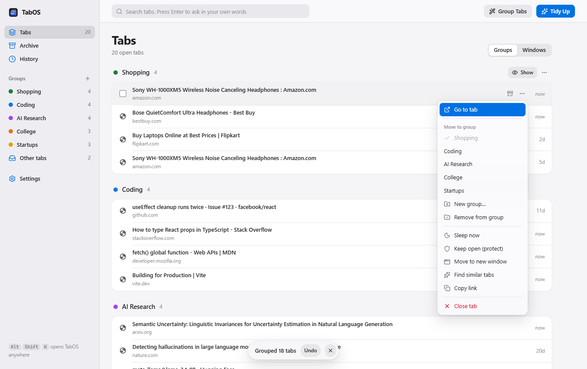
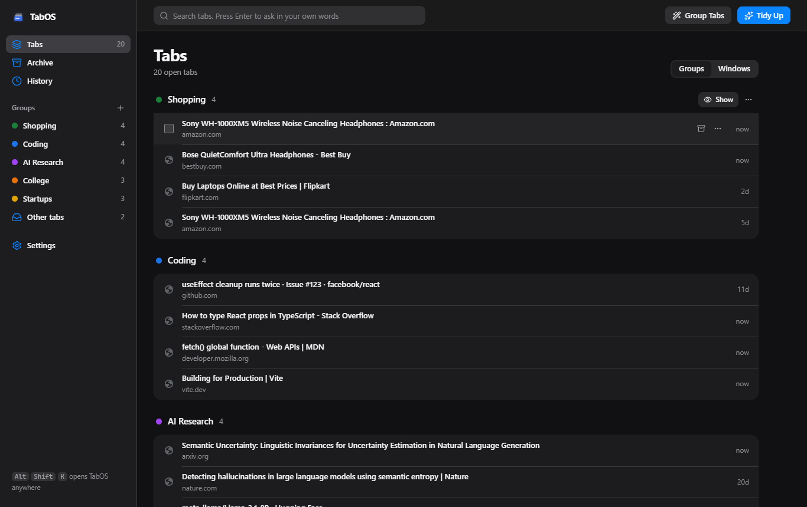
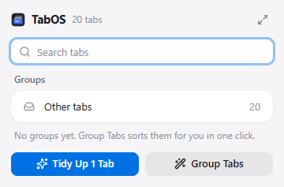

<p align="center">
  
</p>

<h1 align="center">TabOS</h1>

<p align="center">
  A tab manager for Chrome that keeps 100+ tabs under control.<br>
  Workspaces, automatic sleeping, safe archiving, full recovery, and local-first AI search.
</p>

<p align="center">
  <a href="https://github.com/anabansal/tabos/actions/workflows/ci.yml"></a>
  
  
</p>

<p align="center">
  
</p>

## Why

Most people with dozens of tabs open have the same three problems: Chrome uses a lot of memory, the tab strip becomes unreadable, and closing anything feels risky because you might need it later. TabOS fixes all three without asking you to change how you browse:

- **Tabs you leave alone fall asleep** and give memory back. They stay in your tab strip and reload when clicked.
- **Tabs are sorted into groups**, the same groups you see in Chrome's tab strip. One click sorts them for you, or let TabOS keep doing it as you browse.
- **Nothing is ever lost.** Archive closes a tab but keeps it, everything can be undone, and your tabs survive browser restarts.
- **You can find anything again**, even with a vague description like *"that paper about semantic entropy I opened last week"*.

Everything runs on your computer. No account, no server, no tracking.

## How it works

TabOS has three places and two buttons.

| | |
|---|---|
| **Tabs** | Every open tab in every window, sectioned by group (or by window). Hover a tab to archive it; the ⋯ menu moves it to another group, keeps it awake, or finds similar tabs. Drag tabs onto a group in the sidebar. |
| **Archive** | Tabs you closed but kept. Reopen one, or a whole group, any time. Nothing here is deleted unless you delete it. |
| **History** | Recently closed tabs, saved sessions (all your windows, restorable in one click), and Undo for anything TabOS did. |
| **Group Tabs** | Suggests groups such as *AI Research*, *Coding*, *College*, *Shopping* and *Startups*. You can rename, move or skip anything, then apply. Turn on **Group new tabs automatically** and new tabs sort themselves. |
| **Tidy Up** | One screen: put idle tabs to sleep, archive tabs you seem done with, close duplicate copies. Review exactly which tabs, then one button. |

<p align="center">
  
</p>

<table>
  <tr>
    <td></td>
    <td></td>
  </tr>
  <tr>
    <td align="center">Tidy Up: three switches, one button</td>
    <td align="center">Search in your own words</td>
  </tr>
  <tr>
    <td></td>
    <td></td>
  </tr>
  <tr>
    <td align="center">Everything else lives in one menu</td>
    <td align="center">Light and dark appearance</td>
  </tr>
</table>

<p align="center">
  <br>
  <sub>The popup: <kbd>Alt</kbd>+<kbd>Shift</kbd>+<kbd>K</kbd></sub>
</p>

### What happens on its own

- Every tab in every Chrome window is tracked (incognito never is).
- Tabs idle for 45 minutes fall asleep. The tab you're looking at, tabs playing audio, pinned tabs, protected tabs and sites like Google Meet, Zoom and Slack never do.
- A new tab joins the group of the tab it was opened from.
- Naming a tab group in Chrome creates the matching group in TabOS, and renames flow both ways.
- Your windows are saved every 30 minutes for crash recovery.
- Optional: **Group new tabs automatically** (confident matches only; a new group appears once 3 tabs share a topic) and **Archive tabs I haven't used in a while** (always with a notification and Undo).

### More features

- **Windows:** switch Tabs to *Windows* to see each window, merge them, or archive or save one as a session. Move tabs between windows from the ⋯ menu.
- **Search everywhere:** the popup, the dashboard toolbar, and the address bar (type `tab` then a space).
- **Similar tabs:** finds pages about the same thing across different sites.
- **Duplicates:** the same page open twice (ignoring tracking parameters and `#anchors`) is offered for closing in Tidy Up.
- **Private AI by default:** grouping, search and similar tabs run offline. You can optionally connect Ollama (on your computer), any OpenAI-compatible API, or the Anthropic API. Anything that would leave your device needs your explicit consent and never includes page contents.

## Install

TabOS isn't on the Chrome Web Store yet. Install it from source in about a minute:

1. Install [Node.js](https://nodejs.org) 20.19 or newer.
2. Clone and build:
   ```bash
   git clone https://github.com/anabansal/tabos.git
   cd tabos
   npm install
   npm run build
   ```
3. Open `chrome://extensions`, turn on **Developer mode** (top right), click **Load unpacked**, and choose the `dist` folder.
4. Pin TabOS to the toolbar. TabOS opens with a short welcome and a **Group Tabs** button.

Works in Chrome 120+ and should work in other Chromium browsers (Edge, Brave, Arc), though those are not tested yet.

## Using TabOS

| Do this | How |
|---|---|
| Find a tab | Click the toolbar icon (or <kbd>Alt</kbd>+<kbd>Shift</kbd>+<kbd>K</kbd>) and type. Or type `tab` + space in the address bar. |
| Sort your tabs | **Group Tabs** → **Suggest Groups** → **Apply Groups**. |
| Free memory | Nothing to do: idle tabs sleep on their own. For more, press **Tidy Up**. |
| Jump to a group | Click it in the popup, or **Show in Chrome** on its page. |
| Keep a tab awake | ⋯ → **Keep open (protect)**. |
| Get something back | **Archive** or **History**, or press **Undo** on any message. |

Shortcuts can be changed at `chrome://extensions/shortcuts`.

## Permissions

TabOS asks only for what it needs and explains the rest when you turn a feature on.

| Permission | Why |
|---|---|
| `tabs`, `tabGroups` | Read tab titles and URLs and manage tabs and groups. This is the core of the extension. |
| `storage`, `unlimitedStorage` | Keep tab records, groups and saved sessions in local IndexedDB. |
| `alarms` | Check for idle tabs every minute and take periodic snapshots. |
| `notifications` | Only to announce automatic archiving with an Undo button. |
| `favicon` | Show site icons for archived and closed tabs from Chrome's local cache. |
| `system.memory` | Show real system memory numbers (Chrome doesn't expose per-tab memory to extensions). |

Optional, requested only when you enable the related feature:

| Permission | Feature |
|---|---|
| `sessions` | Restore from Chrome's own recently closed list. |
| `history` | Search your browsing history from TabOS. |
| `scripting` + site access | Read `<meta>` descriptions to improve search. Never runs on AI chat apps, email, banking or sign-in pages, and never reads page text. |
| Access to your AI provider's address | Only if you connect Ollama or an external API. |

See [PRIVACY.md](PRIVACY.md) for the full data policy.

## AI providers

| Provider | Embeddings | Naming | Data leaves your device |
|---|---|---|---|
| **Built-in** (default) | ✓ | ✓ | No |
| **Ollama** on your computer | ✓ | ✓ | No (unless you point it at a remote server) |
| **OpenAI-compatible API** (OpenAI, OpenRouter, Groq, LM Studio, vLLM…) | ✓ | ✓ | Yes, after you consent |
| **Anthropic API** | | ✓ | Yes, after you consent |

The built-in model combines hashed word, phrase and character features with a curated topic taxonomy (about 570 sites plus keyword sets across 14 topics). It is instant, deterministic and offline. For deeper semantic matching (synonyms, paraphrases), connect Ollama with an embedding model such as `nomic-embed-text`:

```bash
ollama pull nomic-embed-text
ollama pull llama3.2
```

Then open Settings → More settings → AI → **Use another AI service**, pick Ollama, and press **Save and test**.

Only tab titles, URLs and (if enabled) meta descriptions are ever sent to a provider, never page contents. Excluded sites are never sent. API keys are stored only on your device and are left out of exports.

## Development

```bash
npm install
npm run dev          # rebuild dist/ on every change (then click reload on chrome://extensions)
npm run build        # typecheck + production build into dist/
npm test             # unit tests (Vitest)
npm run test:e2e     # end-to-end tests in real Chrome for Testing
npm run screenshots  # regenerate docs/screenshots from a scripted walkthrough
npm run demo         # open a separate Chrome window with TabOS and sample tabs to try it
```

The end-to-end suite downloads Chrome for Testing on first run (`npx puppeteer browsers install chrome`) and loads the built extension. It covers tracking, sleeping and protection, archive and undo, restore, duplicates, two-way tab-group sync, group inheritance, saved sessions, moving and merging windows, Tidy Up, automatic grouping, and a full browser restart.

### Project layout

```
src/
  background/     service worker: event tracking, reconcile, operations, alarms, RPC router
  core/           pure logic: protection rules, duplicates, restart reconcile, lexical search
  ai/             replaceable AI layer: providers, local embeddings, taxonomy, clustering,
                  organize pipeline, query parser, semantic search, related tabs, smart archive
  shared/         types, settings, IndexedDB schema (Dexie), typed RPC contract, URL helpers
  ui/             shared React components, hooks, design tokens
  dashboard/      full-page dashboard and its views
  popup/          toolbar popup
  integrations/   interface for future, permission-compliant AI-conversation sources
tests/unit/       Vitest
tests/e2e/        Puppeteer + node:test against Chrome for Testing
```

See [docs/ARCHITECTURE.md](docs/ARCHITECTURE.md) for how the pieces fit together.

## Status

**Implemented:** everything described above, the popup, the dashboard, settings, export and import, and both test suites.

**Known limitations**

- Chrome doesn't let extensions measure memory per tab, so TabOS shows system memory measured by the OS and never claims exact savings.
- Sleeping a tab is Chrome's "discard". Pages that keep unsaved form input only in memory can lose it. Protect those tabs or sites.
- The built-in AI is lexical plus a topic taxonomy, not a neural model. Connect Ollama or an API for true semantic embeddings. An in-browser neural model is on the roadmap.
- Edge, Brave and other Chromium browsers are untested.
- AI-conversation integrations (for example, importing official chat exports) exist only as an interface in `src/integrations/types.ts`. Nothing scrapes chat apps.

**Roadmap:** Chrome Web Store release, an in-browser embedding model (WebGPU/WASM), optional sync between devices via the user's own storage, and keyboard-first command palette.

## Contributing

Issues and pull requests are welcome. Please read [CONTRIBUTING.md](CONTRIBUTING.md) first.

## License

[MIT](LICENSE) © Anant Bansal
