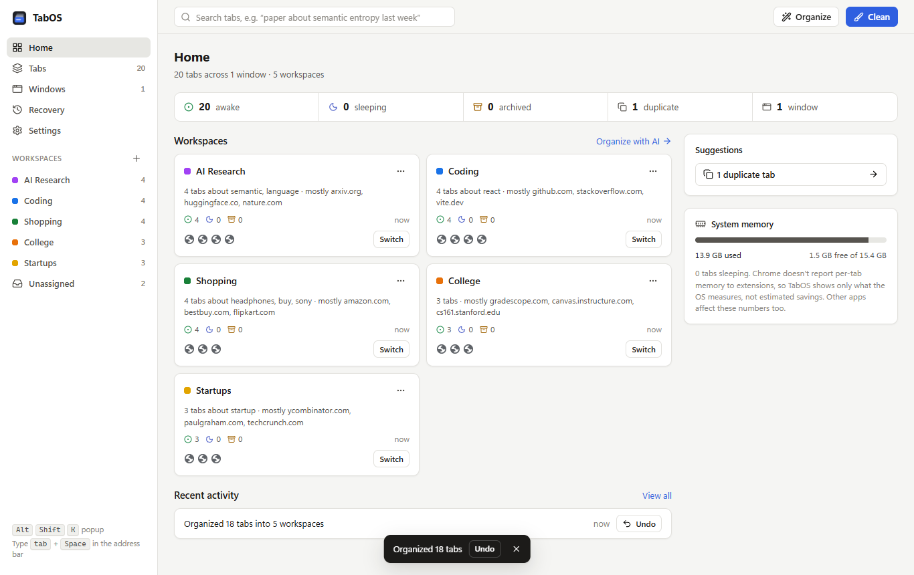
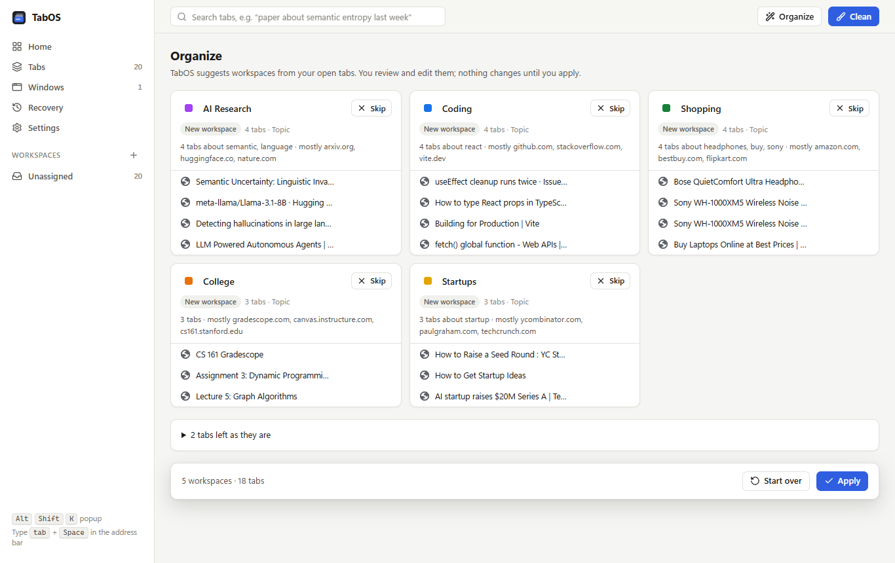
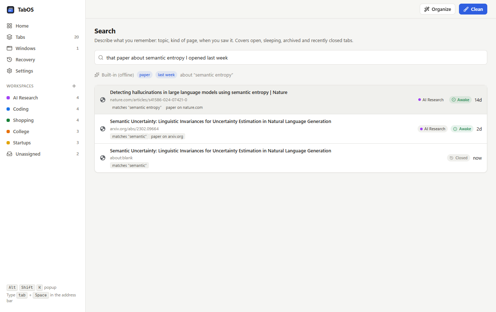
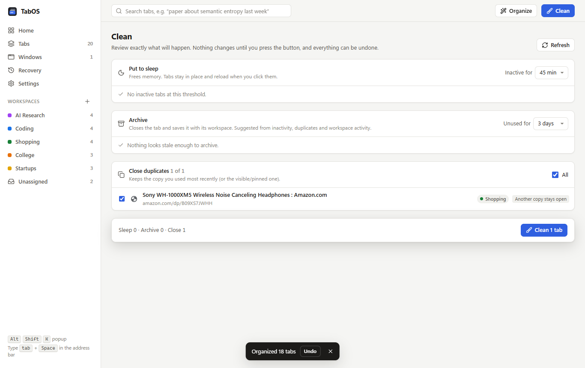
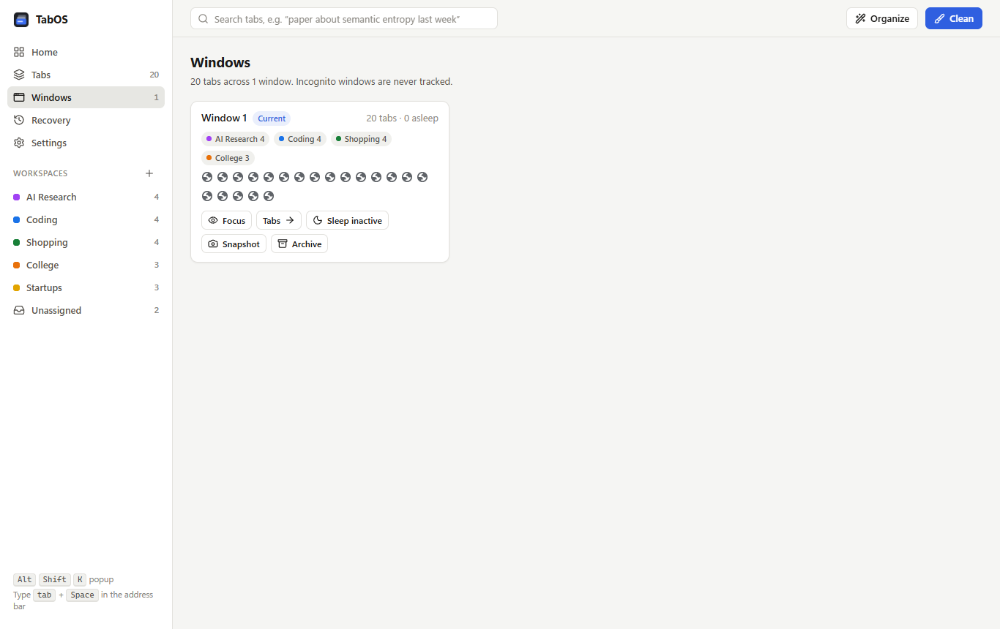
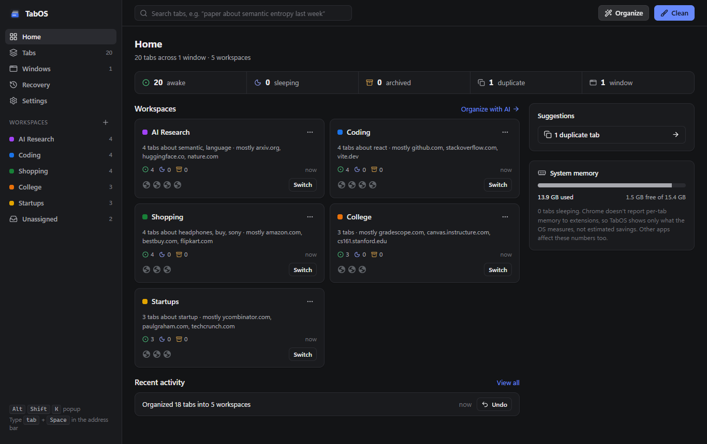
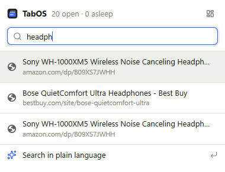

<p align="center">
  
</p>

<h1 align="center">TabOS</h1>

<p align="center">
  A tab manager for Chrome that keeps 100+ tabs under control.<br>
  Workspaces, automatic sleeping, safe archiving, full recovery, and local-first AI search.
</p>

<p align="center">
  <a href="https://github.com/anabansal/tabos/actions/workflows/ci.yml"></a>
  
  
</p>

<p align="center">
  
</p>

## Why

Most people with dozens of tabs open have the same three problems: Chrome uses a lot of memory, the tab strip becomes unreadable, and closing anything feels risky because you might need it later. TabOS fixes all three without asking you to change how you browse:

- **Inactive tabs fall asleep** and give memory back. They stay in your tab strip and reload when clicked.
- **Tabs are grouped into workspaces** (by hand, from Chrome tab groups, or suggested by AI) that you can switch between.
- **Nothing is ever lost.** Archiving closes a tab but keeps it, every action has Undo, and sessions survive browser restarts.
- **You can find anything again**, even with a vague description like *"that paper about semantic entropy I opened last week"*.

Everything runs locally. No account, no server, no tracking.

## Features

### Tab management

| | |
|---|---|
| **Every tab, every window** | Tracks URL, title, site, created / last-active time, and state (awake, sleeping, archived, closed) across all windows. Incognito is never tracked. |
| **Workspaces** | Create, rename, recolor, protect, delete (with undo) and switch. New tabs join the workspace of the tab they were opened from. Two-way sync with Chrome tab groups: name a group and it becomes a workspace. |
| **Automatic sleeping** | Uses Chrome's tab discarding after a configurable idle time. Never touches the visible tab, tabs playing audio, pinned tabs (configurable), protected tabs, protected sites (Meet, Zoom, Slack… by default) or protected workspaces. |
| **Archiving** | Closes a tab but keeps its title, URL, workspace, window position and tab group so it can be restored exactly. Automatic archiving is off by default; when enabled it always posts a notification with Undo. Archived tabs are never deleted automatically. |
| **Restore** | Reopen single tabs, whole workspaces (into a grouped window), or full session snapshots. Large restores open asleep, so memory doesn't spike. |
| **Duplicates** | Finds tabs pointing at the same page (ignoring tracking parameters, `#anchors`, YouTube timestamps). You pick which copy to keep. |
| **Windows** | See every window at a glance, move tabs between windows or into a new one, merge all windows, and sleep, archive or snapshot a whole window. |
| **Recovery** | Recently closed tabs, manual and automatic snapshots, the full undo history, and (optional) Chrome's own recently-closed list and browsing history. |
| **Clean** | One page that shows exactly what will be slept, archived or closed, with reasons, before anything happens. |
| **Search everywhere** | Popup search-as-you-type, dashboard search, and the address bar: type `tab` then a space. |

### AI organization and search

| | |
|---|---|
| **Organize** | Groups tabs into workspaces such as *AI Research*, *Coding*, *College*, *Shopping* and *Startups*, names them and writes a one-line summary. You review, rename, move tabs, skip groups, then apply. One-click undo. |
| **Auto-organize** (optional) | Turn it on and new tabs sort themselves: a tab that clearly belongs to a workspace joins it (and its Chrome tab group), and once 3 unsorted tabs share a topic TabOS creates that workspace for you. Confident matches only, runs offline, never overrides a choice you made, and every change has Undo. |
| **Natural-language search** | Understands topic, kind of page ("paper", "video", "repo", "docs"), time ("yesterday", "last week", "3 days ago", "on Monday") and state ("archived", "I closed"). Each result says why it matched. |
| **Related tabs** | Finds pages about the same thing across different sites. |
| **Smart archive suggestions** | Scores tabs by inactivity, duplication and workspace activity. Suggestions only; you approve in Clean. |
| **Replaceable AI layer** | Works fully offline with the built-in model. Optionally connect Ollama (local), any OpenAI-compatible API, or the Anthropic API for embeddings and naming. External providers require explicit consent and never receive page contents. |

<p align="center">
  
</p>

<table>
  <tr>
    <td></td>
    <td></td>
  </tr>
  <tr>
    <td align="center">Natural-language search</td>
    <td align="center">Clean: review before anything changes</td>
  </tr>
  <tr>
    <td></td>
    <td></td>
  </tr>
  <tr>
    <td align="center">Every window at a glance</td>
    <td align="center">Light and dark themes</td>
  </tr>
</table>

<p align="center">
  <br>
  <sub>Popup: <kbd>Alt</kbd>+<kbd>Shift</kbd>+<kbd>K</kbd></sub>
</p>

## Install

TabOS isn't on the Chrome Web Store yet. Install it from source in about a minute:

1. Install [Node.js](https://nodejs.org) 20.19 or newer.
2. Clone and build:
   ```bash
   git clone https://github.com/anabansal/tabos.git
   cd tabos
   npm install
   npm run build
   ```
3. Open `chrome://extensions`, turn on **Developer mode** (top right), click **Load unpacked**, and choose the `dist` folder.
4. Pin TabOS to the toolbar. The dashboard opens with a short welcome.

Works in Chrome 120+ and should work in other Chromium browsers (Edge, Brave, Arc), though those are not tested yet.

## Using TabOS

| Do this | How |
|---|---|
| Find a tab | Click the toolbar icon (or <kbd>Alt</kbd>+<kbd>Shift</kbd>+<kbd>K</kbd>) and type. Or type `tab` + space in the address bar. |
| Free memory | Nothing to do: idle tabs sleep after 45 minutes. For more, press **Clean**. |
| Sort tabs into workspaces | Dashboard → **Organize** → review → **Apply**. Or turn on **Sort new tabs automatically** (Settings) and let TabOS do it as you browse. |
| Switch workspace | Click a workspace in the popup, or **Switch** on its card. |
| Keep a tab alive | Tab menu → **Protect**, or add the site under Settings → Protected sites. |
| Get something back | Dashboard → **Recovery**, or press **Undo** on any notification or activity entry. |
| Open the dashboard | <kbd>Alt</kbd>+<kbd>Shift</kbd>+<kbd>D</kbd> |

Shortcuts can be changed at `chrome://extensions/shortcuts`.

## Permissions

TabOS asks only for what it needs and explains the rest when you turn a feature on.

| Permission | Why |
|---|---|
| `tabs`, `tabGroups` | Read tab titles and URLs and manage tabs and groups. This is the core of the extension. |
| `storage`, `unlimitedStorage` | Keep tab records, workspaces and snapshots in local IndexedDB. |
| `alarms` | Check for idle tabs every minute and take periodic snapshots. |
| `notifications` | Only to announce automatic archiving with an Undo button. |
| `favicon` | Show site icons for archived and closed tabs from Chrome's local cache. |
| `system.memory` | Show real system memory numbers (Chrome doesn't expose per-tab memory to extensions). |

Optional, requested only when you enable the related feature:

| Permission | Feature |
|---|---|
| `sessions` | Restore from Chrome's own recently closed list. |
| `history` | Search your browsing history from TabOS. |
| `scripting` + site access | Read `<meta>` descriptions to improve search. Never runs on AI chat apps, email, banking or sign-in pages, and never reads page text. |
| Access to your AI provider's address | Only if you connect Ollama or an external API. |

See [PRIVACY.md](PRIVACY.md) for the full data policy.

## AI providers

| Provider | Embeddings | Naming | Data leaves your device |
|---|---|---|---|
| **Built-in** (default) | ✓ | ✓ | No |
| **Ollama** on your computer | ✓ | ✓ | No (unless you point it at a remote server) |
| **OpenAI-compatible API** (OpenAI, OpenRouter, Groq, LM Studio, vLLM…) | ✓ | ✓ | Yes, after you consent |
| **Anthropic API** | | ✓ | Yes, after you consent |

The built-in model combines hashed word, phrase and character features with a curated topic taxonomy (about 570 sites plus keyword sets across 14 topics). It is instant, deterministic and offline. For deeper semantic matching (synonyms, paraphrases), connect Ollama with an embedding model such as `nomic-embed-text`:

```bash
ollama pull nomic-embed-text
ollama pull llama3.2
```

Then pick Ollama in Settings → More settings → AI → Connect a provider, and press **Save and test**.

Only tab titles, URLs and (if enabled) meta descriptions are ever sent to a provider, never page contents. Excluded sites are never sent. API keys are stored only on your device and are left out of exports.

## Development

```bash
npm install
npm run dev          # rebuild dist/ on every change (then click reload on chrome://extensions)
npm run build        # typecheck + production build into dist/
npm test             # unit tests (Vitest)
npm run test:e2e     # end-to-end tests in real Chrome for Testing
npm run screenshots  # regenerate docs/screenshots from a scripted walkthrough
```

The end-to-end suite downloads Chrome for Testing on first run (`npx puppeteer browsers install chrome`) and loads the built extension. It covers tracking, sleeping and protection, archive and undo, restore, duplicates, two-way tab-group sync, workspace inheritance, snapshots, moving and merging windows, Clean, auto-organize, and a full browser restart.

### Project layout

```
src/
  background/     service worker: event tracking, reconcile, operations, alarms, RPC router
  core/           pure logic: protection rules, duplicates, restart reconcile, lexical search
  ai/             replaceable AI layer: providers, local embeddings, taxonomy, clustering,
                  organize pipeline, query parser, semantic search, related tabs, smart archive
  shared/         types, settings, IndexedDB schema (Dexie), typed RPC contract, URL helpers
  ui/             shared React components, hooks, design tokens
  dashboard/      full-page dashboard and its views
  popup/          toolbar popup
  integrations/   interface for future, permission-compliant AI-conversation sources
tests/unit/       Vitest
tests/e2e/        Puppeteer + node:test against Chrome for Testing
```

See [docs/ARCHITECTURE.md](docs/ARCHITECTURE.md) for how the pieces fit together.

## Status

**Implemented:** everything in the feature tables above, the popup, the dashboard, settings, export and import, and both test suites.

**Known limitations**

- Chrome doesn't let extensions measure memory per tab, so TabOS shows system memory measured by the OS and never claims exact savings.
- Sleeping a tab is Chrome's "discard". Pages that keep unsaved form input only in memory can lose it. Protect those tabs or sites.
- The built-in AI is lexical plus a topic taxonomy, not a neural model. Connect Ollama or an API for true semantic embeddings. An in-browser neural model is on the roadmap.
- Edge, Brave and other Chromium browsers are untested.
- AI-conversation integrations (for example, importing official chat exports) exist only as an interface in `src/integrations/types.ts`. Nothing scrapes chat apps.

**Roadmap:** Chrome Web Store release, an in-browser embedding model (WebGPU/WASM), optional sync between devices via the user's own storage, and keyboard-first command palette.

## Contributing

Issues and pull requests are welcome. Please read [CONTRIBUTING.md](CONTRIBUTING.md) first.

## License

[MIT](LICENSE) © Anant Bansal
